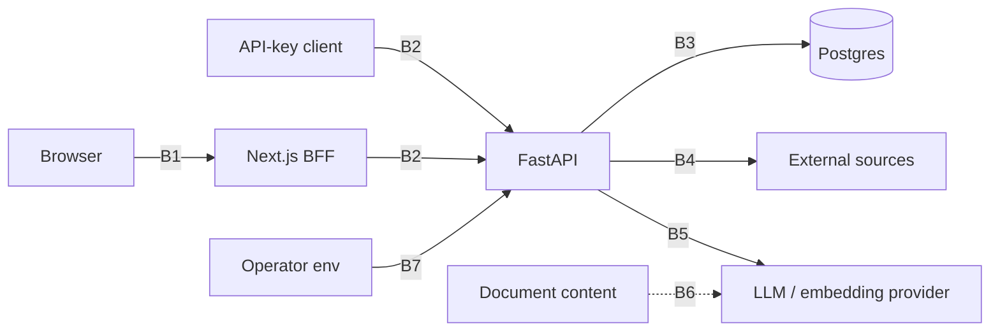

# Threat model

STRIDE per trust boundary. "Mitigation" lists only what the code does today. Gaps are collected at
the end, with their backlog status. Controls in detail: [SECURITY.md](SECURITY.md).

## Assets

Tenant documents and chunks; connector credentials and OAuth tokens; user passwords, sessions and
API keys; LLM spend; audit trail; agent reports.

## Trust boundaries

## B1: Browser ↔ BFF

| Threat | Mitigation | Gap |
|---|---|---|
| S: session theft via XSS | Tokens only in httpOnly cookies; CSP `default-src`/`connect-src 'self'` (`tests/bff-edge.test.ts`) | `script-src` allows `'unsafe-inline'` (App Router inline scripts) |
| T: CSRF on state-changing calls | `Sec-Fetch-Site` / `Origin` check on session routes and proxied non-GET; JSON-only session POSTs; SameSite=Lax | |
| T: path traversal through the proxy | Segment guard + origin/prefix assertion (`tests/bff-proxy.test.ts`) | |
| I: open redirect after login | `safeNext` same-origin check (`tests/safe-next.test.ts`) | |
| I: OAuth redirect to an attacker host | Per-type https host allowlist (`lib/oauth.ts`) | |
| E: clickjacking | `X-Frame-Options: DENY` + `frame-ancestors 'none'` on Next; `X-Frame-Options: DENY` on the API | |

## B2: Client ↔ API

| Threat | Mitigation | Gap |
|---|---|---|
| S: password guessing | Argon2, per-IP auth rate limit failing closed, constant-time unknown-email path | No account lockout or CAPTCHA |
| S: stolen refresh token | Rotation + reuse detection revokes the family; audit `session.reuse_detected` | Access token valid ≤ 15 min after revoke |
| S: stolen API key | HMAC-stored, revocable, expiry, scope-capped, creator's current role | No IP allowlist per key |
| T: privilege escalation | Scope + role on every route (route-table test); owner rules; keys cannot mint wider keys | |
| R: deny an action | Append-only audit log in the action's transaction, request id, hashed IP | Audit rows keep actor ids, not an email snapshot (backlog) |
| I: other tenant's data | RLS on every tenant table incl. `users` (own row + current org's members; no `pw_hash` read), 404 for foreign ids, per-user privacy for conversations/runs | |
| S/E: account pre-registered with a colleague's email joins an org | Add-member is an invite; joining needs the signed-in invitee to accept; expiry 7 days; revocable; audited | No email verification yet: the first registrant of an address can accept invites to it |
| I: email existence oracle | Invite answer identical for known/unknown emails | Register still returns 409 `email_taken` (normal) |
| I: error detail leaks | Generic 500s; mapped LLM errors; no query strings in logs | |
| D: request floods / cost blow-up | Rate limits; budgets before LLM/embedding calls; upload size cap; agent step and token limits | Non-auth limiters fail open if Redis is down; budget is soft (concurrent calls can overshoot by one call each) |
| D: rate-limit bucket collapse behind a proxy | BFF forwards the client IP (`TRUSTED_PROXY_HOPS`); API believes XFF only from `FORWARDED_ALLOW_IPS` (`tests/test_ratelimit.py`) | Next exposed without a proxy keeps a client-sent XFF |

## B3: API/worker ↔ Postgres

| Threat | Mitigation | Gap |
|---|---|---|
| E: app bypasses RLS | `rag_app` is NOSUPERUSER NOBYPASSRLS; `FORCE` RLS; tenancy test checks the role | |
| E: SECURITY DEFINER abuse | Fixed `search_path`, PUBLIC revoked, org-scoped bodies, narrow outputs | Owners are non-superusers (`rag_definer` BYPASSRLS, `rag_owner`; ADR 0009); `due_sync_orgs(stale_after)` accepts any interval, so a caller can probe which orgs have running syncs (org ids only; backlog: clamp) |
| T: SQL injection | ORM / bound parameters; no user or model SQL; Postgres connector quotes catalog-checked identifiers | |
| T: audit tampering | `UPDATE/DELETE/TRUNCATE` revoked from `rag_app` on `audit_log` | Owner role can still edit |
| D: DDL deadlocks | `LOCK TABLE` before HNSW create/drop | |

## B4: Workers ↔ external sources

| Threat | Mitigation | Gap |
|---|---|---|
| S/I: SSRF to internal services or metadata | Public-unicast DNS check on every hop, IP pinning, IPv6-embedded IPv4 unwrapped, port allowlist, private gate | |
| T: DNS rebinding | Any blocked answer refuses the host; connect to the checked IP | |
| I: crawling behind logins | 401/403 treated as absent; robots.txt honored (conservative when unreachable) | |
| E: write access through a DB connector | Read-only session; write-capable roles and superusers refused at save and sync | |
| I: OAuth code injection / state replay | PKCE S256, single-use `state` via GETDEL, 10 min TTL; membership re-checked at callback | Start route has no own rate limit |
| I: over-broad access via connectors | – | Drive/OneDrive/Dropbox ACLs not enforced per user: KB-level access only (documented in each connector) |
| D: huge or endless sources | Page/object/row/file caps, 5 MB page cap, sync time limit 4 h, stale-run reaper | |

## B5: API/worker ↔ LLM and embedding providers

| Threat | Mitigation | Gap |
|---|---|---|
| I: tenant data sent to a provider | Only retrieved chunks of the caller's KBs; provider chosen by the operator | No per-org provider or data-residency routing (planned) |
| I: API key leak | Keys only in env; scrubbed from logs | |
| D: provider outage | Timeouts, retries, optional fallback model, readable error events | |

## B6: Document content → model (prompt injection)

| Threat | Mitigation | Gap |
|---|---|---|
| T: injected instructions in a document | Escaped `<sources>` fence + "untrusted data" system rule; agent tool outputs wrapped as `untrusted_data` | A live model has never been tested against the injection fixtures (credentials) |
| E: injected text triggers a tool or approval | Tools and risks fixed in code; write tools need a person's approval; unknown tools/extra args rejected (AC10 test) | |
| T: fabricated citations | Citation markers validated against packed context; unknown ones stripped (AC5 test) | |
| T: CSV / XLSX formula injection | Formula-leading cells prefixed or stored as text | |

## B7: Operator configuration

| Threat | Mitigation | Gap |
|---|---|---|
| I: weak or missing secrets | Startup validation of `JWT_SECRET` length and Fernet keys; compose fails without required vars | |
| I: rotating `JWT_SECRET` kills all API keys | Separate `API_KEY_PEPPER` setting | Falls back to a JWT-derived pepper when unset |
| E: private-network access by accident | Private endpoints off unless the server gate is set | |

## Known gaps

| Gap | Status |
|---|---|
| No email verification at registration (invites trust the address) | deferred until an email provider exists |
| No CSP / X-Frame-Options / HSTS | open |
| Connector ACLs not enforced per user (Drive, OneDrive, Dropbox) | documented limitation |
| `due_sync_orgs(stale_after)` caller-chosen interval | backlog: clamp server-side |
| Audit rows without actor email snapshot | backlog |
| No CI: no automated secret scan, dependency audit, or test gate | backlog |
| `messages` RLS is org-level (its conversation is per-user); reads always go through the conversation, so no route exposes it | defense-in-depth note |
| Whole-repo security audit (task B7b) | planned |
